# Do Robot Policies Adapt to Geometry?

**Diagnosing and Learning Geometry-Conditioned Behavior in Insertion Tasks**

Master's thesis, Department of Computer Science and Information Engineering,
National Cheng Kung University. Built on
[NVIDIA Isaac Lab](https://github.com/isaac-sim/IsaacLab).

**Accepted at [IEEE/SICE SII 2027](https://sii2027.sice-si.org), Kobe, Japan.**

---

**[Why success rate is not enough](#success-rate-does-not-tell-you-what-a-policy-learned)** ·
**[What this is](#what-this-is)** ·
**[1. The benchmark](#1-the-diagnostic-benchmark)** ·
**[2. The learning method](#2-relative-geometry-appearance-loss)** ·
**[3. What I built](#3-what-i-built)** ·
[Getting started](#getting-started) ·
[Datasets](#datasets) ·
[Side contribution: Techman TM7s](#side-contribution-techman-tm7s-in-isaac-lab)

---

## Success rate does not tell you what a policy learned

Success rate says whether a policy finished the task. It is what almost every
manipulation benchmark reports, and it says nothing about *how* the task was
done. That gap is where the useful information is.

For manipulation, the behavior worth watching is geometric. A good policy
should change what it does when the shape changes: align carefully for a tight
hole, go straight in for a loose one, pick the orientation that actually fits.
Those choices happen during the rollout, and they can be measured.
**Measuring them tells you things success rate cannot.**

Here is an example.

### One word, "failure", covering two different problems

Diagnosis 3 places the peg above an X-shaped hole, where one opening is larger than the other. The peg can pass through the larger opening, but not the smaller one. The box is also rotated to a random angle in every episode, so the policy cannot memorize a fixed direction. It has to look at the box, identify the larger opening, and rotate the peg to align with it.

<p align="center">
  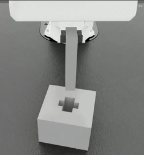
  <br><sub><a href="https://github.com/user-attachments/assets/145ecbea-0943-4c20-a34a-13a763544c8a">full-speed recording</a></sub>
</p>

BC-LSTM succeeds in **15%** of rollouts. On a leaderboard that reads as a model
that cannot do the task at all.

Now look at what happened in the 85 failures:

<p align="center">
  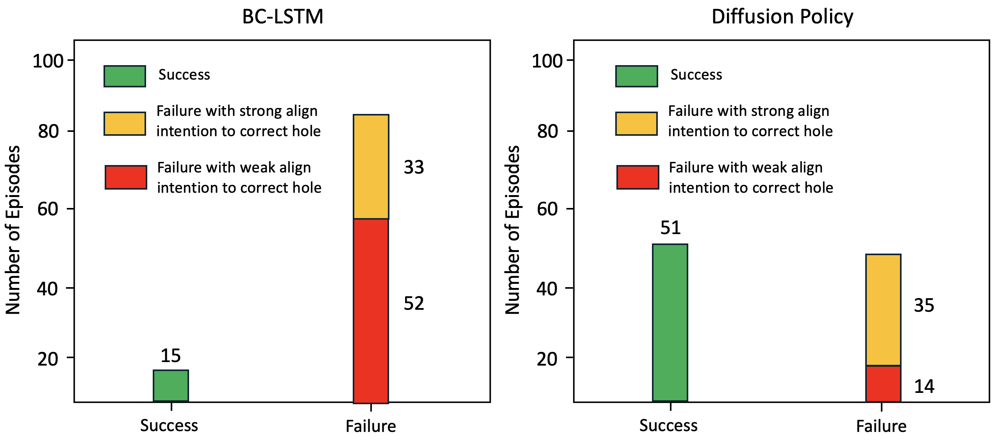
</p>

Thirty-three of them ended with the peg turned toward the correct side. The policy figured out which way the peg should turn, but the insertion still failed because the alignment was slightly off.
Counting those together with the successes, it identified the right side in
**48 of 100** rollouts — more than three times what the success rate suggests.

The other 52 failures are a different problem entirely: the policy turned
toward the side the peg could never fit through.

| BC-LSTM, Diagnosis 3 | |
|---|---|
| Inserted successfully | 15 |
| Aimed at the correct side, missed | 33 |
| Aimed at the wrong side | 52 |

These two failure modes require very different fixes. Aiming at the wrong side is a perception problem — the policy failed to recognize the correct shape or direction. Aiming at the correct side but still failing is a precision problem — the policy understood what to do, but could not execute it accurately enough. **Success rate counts both cases simply as "failures", so it cannot tell us what actually went wrong.** The behavioral metric can, and that is the main purpose of this benchmark.

For comparison, Diffusion Policy identified the correct side in 86 out of 100 rollouts and succeeded in 51 of them. It was better at both understanding the shape and aligning the peg for insertion.

### If not the shape, then what?

A policy that is not using the shape is using something else. Below is the same
tight-hole task twice — same hole, same gap, same motion needed, different
color and texture.

<p align="center">
  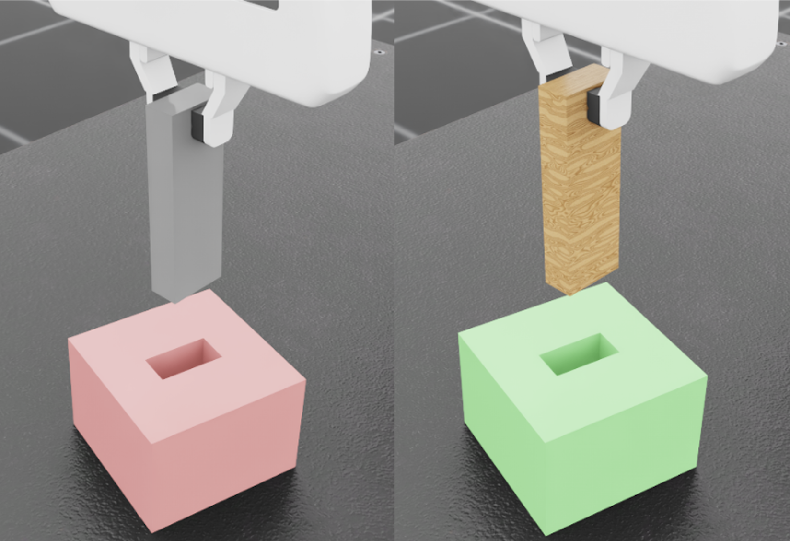
</p>

<p align="center">
  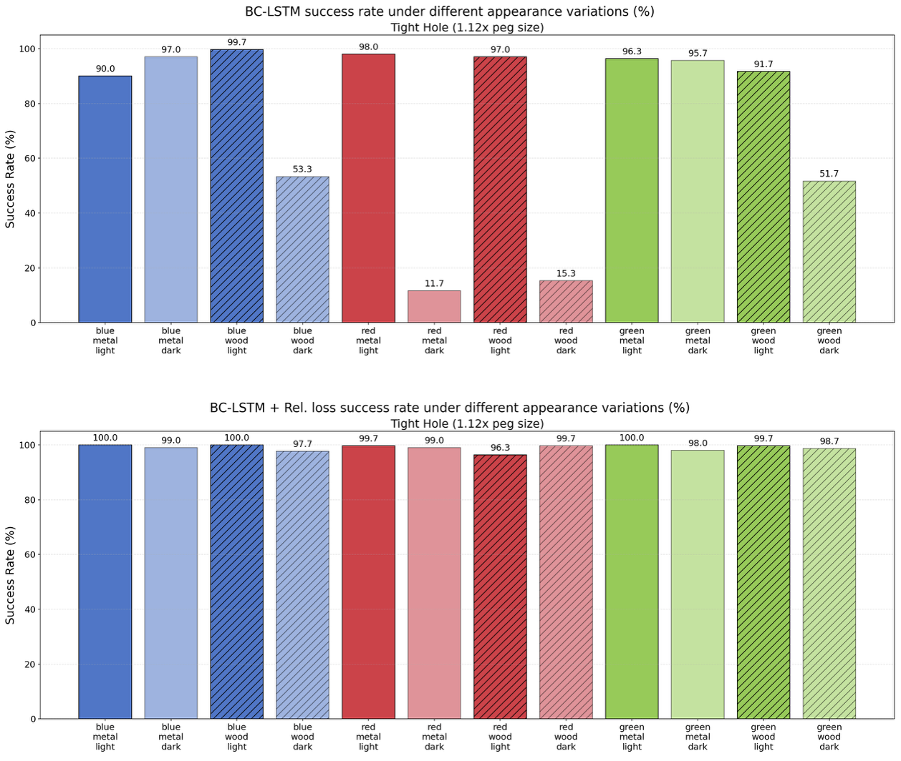
</p>

A standard BC-LSTM (top) gets **99.7%** on one appearance and **11.7%** on
another. Averaging hides it: the same model reports 74.8% overall on the tight
hole, which looks like normal room for improvement rather than a model that
falls apart when the lighting changes.

The bottom half is the same model trained with the **Relative
Geometry-Appearance Loss** proposed here — between 96.3% and 100% on every
appearance.

This repository contains a benchmark for measuring policy behavior during task execution, along with a proposed learning method that aims to reduce this type of shortcut learning.

---

## What this is

**1. A geometry-conditioned diagnostic benchmark.** Five insertion experiments,
each isolating one geometric capability, scored by *behavior* during the
rollout rather than by task outcome alone. Model-agnostic and rollout-based, so
it applies to any policy that can be rolled out — BC, Diffusion Policy, a VLA.

**2. The Relative Geometry-Appearance Loss.** A plug-in auxiliary loss that
makes a policy's *behavior* insensitive to appearance and sensitive to
geometry. Training-only: inference is unchanged.

**3. The environment, data and baselines that make both possible.** All of these components were implemented and integrated into Isaac Lab as part of this work.

| | |
|---|---|
| **Environment** | 3,800-line insertion task package for Isaac Lab; 23 USD geometries; geometry and appearance randomized independently |
| **Data** | 400+ human teleoperation demonstrations collected, ~10.1 GB, packaged per experiment |
| **Baselines** | BC-LSTM through robomimic, and a Diffusion Policy implemented from scratch — Isaac Lab ships no diffusion trainer |
| **Benchmark** | 5 diagnostic experiments, 28 analysis scripts, 10 behavioral metrics implemented and 6 reported in the thesis |
| **Method** | Relative Geometry-Appearance Loss, applied to both baselines |
| **[Also](#side-contribution-techman-tm7s-in-isaac-lab)** | Techman TM7s arm brought into Isaac Lab from a vendor URDF that ships no gripper: merged with a Robotiq 2F-85 into one kinematic tree, converted to USD, and built up to a registered task — fixing the joint oscillation and mesh naming defects on the way |

---

## 1. The diagnostic benchmark

Diagnosis 3 is one of the five experiments in this benchmark. They are independent of each other — not stages of a single test — and each isolates a different aspect of geometric capability: adapting to clearance, covering the strategies a shape allows,
choosing between them, and matching shape to shape. Diagnosis 0 is the
exception, a basic skill check used to confirm a policy can insert at all
before its behavior on the others is worth reading.

<p align="center">
  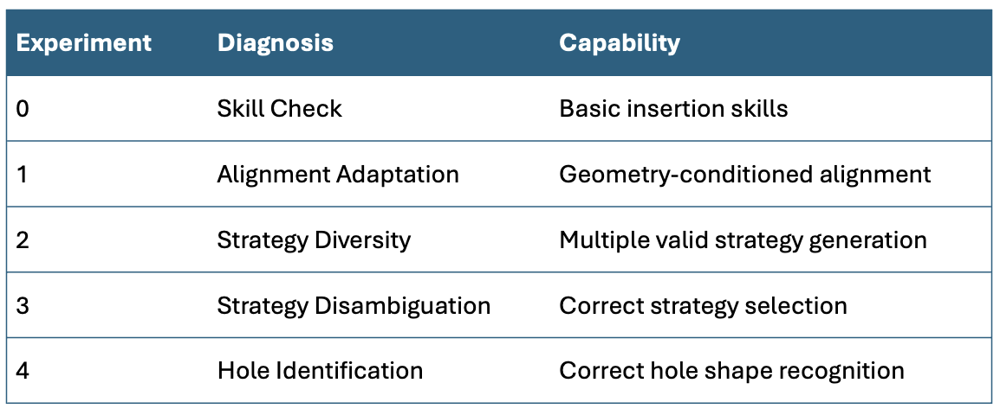
</p>

| # | Diagnosis | Question it answers | Behavioral metric |
|---|---|---|---|
| 0 | Skill Check | Can it insert at all? | success rate (prerequisite) |
| 1 | Alignment Adaptation | Does it align *more* for a tight hole than a loose one? | alignment steps, final yaw difference |
| 2 | Strategy Diversity | When two insertion angles both work, does it use both? | success rate(mode 1) x success rate(mode 2) |
| 3 | Strategy Disambiguation | When only one angle works, does it pick that one? | alignment intention toward the correct slot |
| 4 | Hole Identification | Does it match peg shape to hole shape? | distance from peg to the correct hole center |

| | | |
|:--:|:--:|:--:|
| 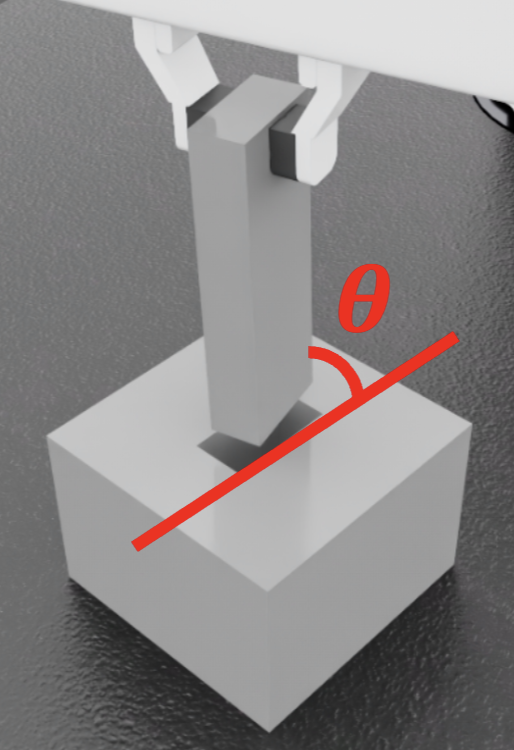 | 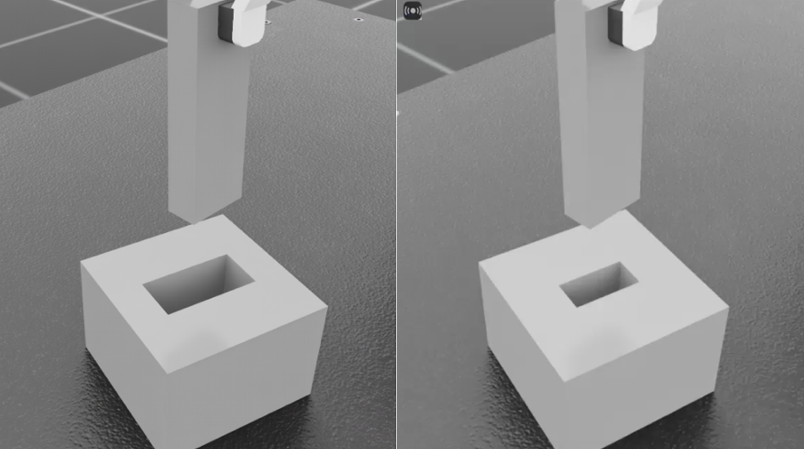 | 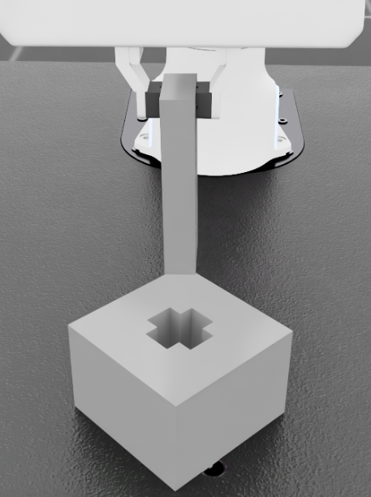 |
| **0** — hole below the peg, continuous yaw offset | **1** — loose vs tight hole, 15° offset | **2** — X-hole, two valid orientations |
| 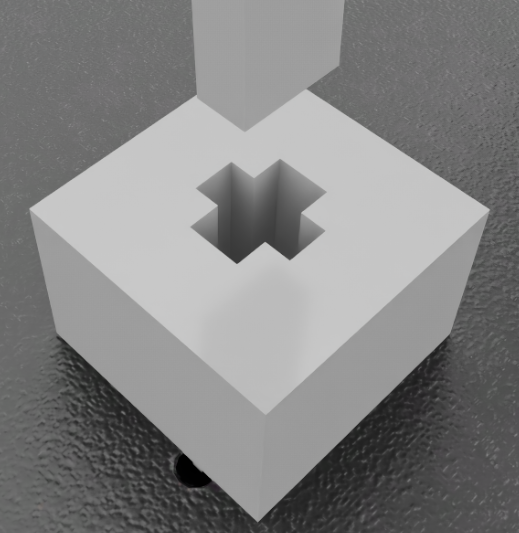 | 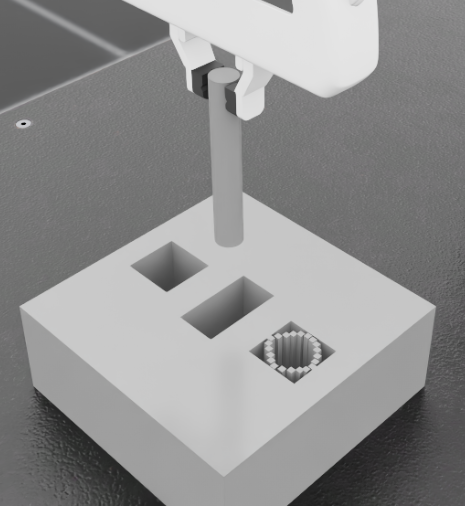 | 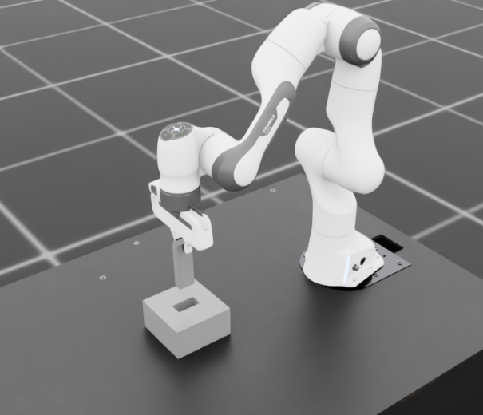 |
| **3** — X-hole, one big arm and one small; only the big arm fits | **4** — three hole shapes, peg drawn at random | the task in Isaac Lab |

Every rollout in this README uses the same observations a real robot would have: **one 200×200 RGB camera image, together with the end-effector position and yaw.** The policy is not given the hole location or size directly — it has to infer them from the image.


### What it found

<p align="center">
  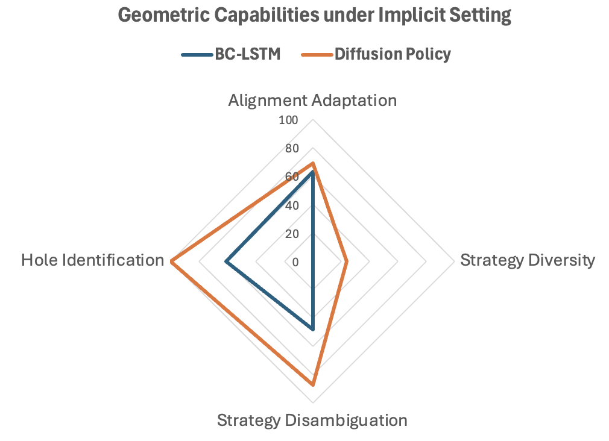
</p>

Diagnosis 3 was one experiment. Across all five, BC-LSTM's weakest result is
Diagnosis 2 - Strategy Diversity, where it scores a flat zero: the X-shaped hole there can be entered at either of two ways, and across 100 rollouts BC-LSTM used one of them every single time and the other never. Diffusion Policy used both.

The chart also shows the pattern from Diagnosis 3 repeating on Hole
Identification — the experiments that need the policy to read a shape from the
image before moving are the ones BC-LSTM struggles with. Diffusion Policy finds the
correct hole in 100% of rollouts against BC-LSTM's 60.7%.

So the benchmark pulls apart two different problems that success rate would
report as one number a bit under 100: BC-LSTM **cannot produce more than one
strategy**, and it **is worse at working out the shape from pixels**.

Every experiment also runs a second time with the hole's exact position and size
given to the policy, which rules out "it just could not see the hole" as the
explanation. Those results are in [`docs/benchmark.md`](docs/benchmark.md).

Full numbers: [`docs/benchmark.md`](docs/benchmark.md) ·
[`images/Results_AllDiagnosis_table.png`](images/Results_AllDiagnosis_table.png)

---

## 2. Relative Geometry-Appearance Loss

If a policy should act *the same* when only appearance changes and *differently*
when geometry changes, that constraint can be written down and trained on
directly.

<p align="center">
  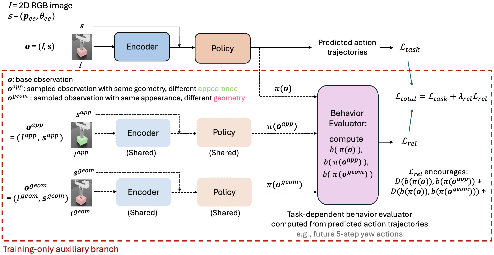
</p>

Every anchor observation is paired with an **appearance pair** (same hole size,
different color/texture/background) and a **geometry pair** (same appearance,
different hole size). All three pass through the shared encoder and policy. The
predicted action trajectories are reduced to a task-dependent *behavior
evaluator* `b` — here the accumulated magnitude of yaw actions over K steps —
and a hinge pulls the appearance pair together while pushing the geometry pair
apart:

```
L_rel   = max(0,  m + D(b(π(o)), b(π(o_app))) − D(b(π(o)), b(π(o_geom))))
L_total = L_task + λ_rel · L_rel
```

This is FaceNet's triplet loss moved from the embedding space to the **behavior
space**. The constraint is applied to what the policy *does*, not to what it
represents. The auxiliary branch exists only during training, so inference cost
is unchanged.

### Results

Alignment Adaptation with appearance variations, tight hole — the hard case:

| | Gradient updates | Success rate |
|---|---|---|
| BC-LSTM | 400 | 74.75% |
| BC-LSTM | 1,000 | 84.36% |
| **BC-LSTM + Rel. loss** | **400** | **98.97%** |
| Diffusion Policy | 20,000 | 58.75% |
| Diffusion Policy | 40,000 | 85.25% |
| **Diffusion Policy + Rel. loss** | **20,000** | **87.14%** |

Both policies beat their own baseline trained for far longer: BC-LSTM at 400
updates beats the 1,000-update baseline, and Diffusion Policy at 20,000 beats
the 40,000-update baseline. Same architecture, same data, 40% and 50% of the
gradient steps.

The gain is not memorization. The behavioral metrics also improve at the same time:

| | Geometric capability ↑ | Alignment steps, tight ↓ | Final yaw diff, tight ↓ |
|---|---|---|---|
| BC-LSTM | 57.00 ± 8.56 | 87.42 ± 18.48 | 1.08° ± 0.88 |
| **BC-LSTM + Rel. loss** | **75.38 ± 8.72** | **64.77 ± 5.16** | **0.54° ± 0.41** |
| Diffusion Policy | 58.08 ± 6.04 | 78.42 ± 8.82 | 1.20° ± 0.13 |
| **Diffusion Policy + Rel. loss** | **61.85 ± 1.97** | **72.81 ± 2.02** | **1.19° ± 0.07** |

For the tight hole, the policy takes fewer alignment steps and ends closer to the target angle. This rules out a simple alternative explanation: that it simply learned to align more aggressively in every case. Instead, it aligns less while still becoming more accurate. The variation in alignment steps also drops sharply, from ±18.5 to ±5.2. This suggests that the policy is less uncertain about whether more rotation is needed, because it can better identify the hole geometry from the image.

On the loose hole all four are close to identical — around 9 steps and a 13.5°
residual — which is the prefered behavior there, and the reason the loose-hole
columns are left out above. The full table, including them, is in
[`docs/relative-loss.md`](docs/relative-loss.md).

<details>
<summary>Per-appearance breakdowns</summary>

Alignment steps: [`images/RelLoss_BCvsBCRel_alignmentSteps_byAppearance.png`](images/RelLoss_BCvsBCRel_alignmentSteps_byAppearance.png)
Final yaw difference: [`images/RelLoss_BCvsBCRel_finalYawDiff_byAppearance.png`](images/RelLoss_BCvsBCRel_finalYawDiff_byAppearance.png)
Anchor sampling algorithm: [`images/RelLoss_anchorPoolAlgo.png`](images/RelLoss_anchorPoolAlgo.png)

</details>

### Scope and limitations

The learning method is currently validated **on Diagnosis 1 (Alignment Adaptation) with appearance variations.** The behavior evaluator b is the only task-specific component, and the yaw-based formulation used here is designed for the alignment behavior evaluated in this setting.

Details: [`docs/relative-loss.md`](docs/relative-loss.md)

---

## 3. What I built

All of the above required several pieces that did not exist yet: a configurable insertion environment, human demonstration data for training, and a second model (i.e., Diffusion Policy) strong enough to make the comparison meaningful. 

The insertion environment itself was a substantial part of the work. It had to support different hole geometries, peg–hole configurations, randomized orientations, and independent changes in geometry and appearance, while still providing stable physics, consistent observations, and a setup that could be used for both teleoperation and policy training.
### The insertion task package

[`manipulation/insert/`](source/isaaclab_tasks/isaaclab_tasks/manager_based/manipulation/insert) —
3,806 lines across 16 modules, following Isaac Lab's manager-based environment
architecture — observation, event, action and termination terms, gym
registration — plus seven robomimic agent configs.

What it needs to do, and does:

- **Independent randomization of geometry and appearance.** Hole clearance, yaw
  offset, peg shape, box color, peg texture and background are separate knobs.
  The Relative Geometry-Appearance Loss depends on this — it needs pairs that
  differ in exactly one of the two.
- **A 4D action space** `[dx, dy, dz, dyaw]` over relative IK, with roll and
  pitch locked and the gripper held closed, so the policy controls precisely the
  degrees of freedom insertion needs and nothing else.
- **Two observation modes** of the same task, registered as separate gym
  environments: one gives the policy the hole's exact pose and size, the other
  gives it only a camera image. Comparing them separates "cannot see it" from
  "can see it but does not use it".
- **23 USD geometries** — pegs in four shapes, hole blocks across a clearance
  sweep, X-holes, asymmetric X-holes and three-shape blocks — driving the five
  diagnostic experiments.

### Changes to Isaac Lab itself

Most of this work adds new files. Three of Isaac Lab's own scripts needed
editing, and one of those edits was **a bug fix**.

`play.py` rolls a trained policy out in the environment. Before handing each
observation to the model it called `torch.squeeze()`, which drops *every*
dimension of length one. With a single environment that is one dimension too
many: an end-effector yaw arrives shaped `(1 env, 1 value)` and comes back as a
bare scalar, with the feature dimension gone. Nothing raises — the tensor is
simply the wrong shape from that point on, and the policy is fed garbage.
The fix removes only the environment dimension, and only when it is actually of
length one.

```python
# before — drops the feature dimension too
for ob in obs:
    obs[ob] = torch.squeeze(obs[ob])

# after — removes the env dimension only
for k, v in obs.items():
    if torch.is_tensor(v) and v.ndim >= 1 and v.shape[0] == 1:
        obs[k] = v.squeeze(0)
```

Rolling out a policy trained on the 4D insertion action needs that action
expanded back into the 7D format the controller expects. That conversion,
behind `--action_4d_to_7d`, lives in [`play_4d.py`](scripts/imitation_learning/robomimic/play_4d.py)
and `play_4d_and_save.py`, the rollout scripts this project actually uses.

`record_demos.py` and `teleop_se3_agent.py` were retuned for insertion rather
than pick-and-place, covered in the next section.

### 400+ human demonstrations

Collected by keyboard teleoperation, at least 50 per diagnostic experiment.
Getting usable data meant retuning the teleoperation first. Insertion needs far
finer control than pick-and-place, so position sensitivity was dropped from 0.05
to 0.0125, rotation sensitivity raised so yaw correction stayed practical, and
the recording rate set to 25 Hz.
[`record_demos_boost.py`](scripts/tools/record_demos_boost.py) adds a hold-`shift`
modifier that temporarily speeds up keyboard motion, so the long approach does not
have to be driven at the fine resolution the final alignment needs.

The operator's view while collecting, one clip per task:

| Diagnosis 2 | Diagnosis 3 | Diagnosis 4 |
|:--:|:--:|:--:|
| 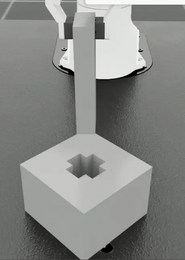 | 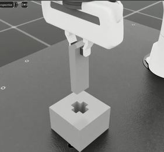 | 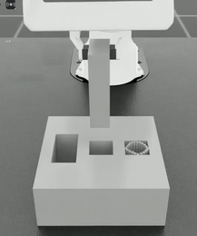 |
| either orientation goes in | only the larger hole allow insertion | match the peg to its hole |

<sub>Shown at 2x. Full-speed recordings:
<a href="https://github.com/user-attachments/assets/cc209c6c-8825-43cc-bb7c-60e3eb6d8863">Diagnosis 2</a> ·
<a href="https://github.com/user-attachments/assets/dc51e5ae-88f5-40b6-8a55-c154f4ffd43e">Diagnosis 3</a> ·
<a href="https://github.com/user-attachments/assets/47024937-12fe-4b29-9435-c1e6276a7b21">Diagnosis 4</a></sub>

A second processing step converts the recorded 7D actions into the 4D action format and adds the clearance scaling for each episode. A third step then builds the anchor pool used by the relative loss.


### Diffusion Policy

Isaac Lab provides no Diffusion Policy trainer, so the benchmark's second
baseline is implemented here against robomimic and wired into the same training
and evaluation path as BC-LSTM — same dataset loader, same rollout scripts, same
metrics — so the two are measured under identical conditions.

A conditional 1D U-Net over action sequences: three downsampling stages with
channel dimensions [256, 512, 1024], kernel size 5, group normalization with 8
groups. Observation horizon 2, action horizon 8, prediction horizon 16. DDIM
sampling with 100 diffusion timesteps at training and 10 at inference under a
squared-cosine noise schedule, predicting the noise term, with EMA at decay
power 0.75 for stability. Visual observations run through a ResNet-18 encoder
initialized from ImageNet with SpatialSoftmax pooling over 32 keypoints.

Diffusion Policy performs better on this benchmark, as also shown in the previous radar plot. More importantly, it can produce both strategies. This shows that the task itself is possible. Therefore, BC-LSTM's zero score is meaningful: the problem is not the benchmark, but that BC-LSTM fails to learn both strategies.

### The rest

| Component | Size | |
|---|---|---|
| [Relative loss trainers](scripts/imitation_learning/robomimic) | 1,816 lines | Anchor pool, triplet sampling, auxiliary loss, for both baselines |
| [Rollout & behavior logging](scripts/imitation_learning/robomimic) | 1,964 lines | Per-step logging of the signals the metrics are computed from |
| [Behavior analysis suite](datasets/behaviorAnalysis_scripts) | 28 scripts, 10,530 lines | Every behavioral metric in the benchmark, and the scripts that plot them |
| [Dataset tooling](datasets) | 1,133 lines | HDF5 inspection, merging, action conversion, anchor pool construction |
| [TM7s integration](source/isaaclab_assets/isaaclab_assets/robots/tm7s.py) | 2,182 lines | See below |

The `source/` and `scripts/` trees mirror Isaac Lab's own layout — these files
are designed to be overlaid onto a checkout, not to live alone.

---

## Getting started

Requires Isaac Sim and Isaac Lab; follow
[Isaac Lab's own installation guide](https://github.com/isaac-sim/IsaacLab) for
the hardware and driver requirements. Developed against Isaac Lab at commit
`f9154913b7`.

**Two conda environments are required.** Behavior cloning and Diffusion Policy
need different robomimic versions, so they cannot share one:

| Environment | robomimic | Used for |
|---|---|---|
| `env_isaaclab` | 0.4.0 | demonstration collection, BC-LSTM training and inference |
| `diffusion_env_isaaclab` | 0.5.0 + `diffusers` | Diffusion Policy training and inference |

Demonstrations are always collected in `env_isaaclab`, including the data later
used to train Diffusion Policy.

```bash
git clone https://github.com/isaac-sim/IsaacLab.git
git clone https://github.com/CrocoWilly/do-policies-adapt-to-geometry.git

# This repository is an overlay: its source/ and scripts/ trees mirror Isaac Lab's
rsync -a --exclude '.git' --exclude 'README.md' --exclude 'docs' \
      do-policies-adapt-to-geometry/ IsaacLab/

cd IsaacLab && ./isaaclab.sh --install
conda env create -f docs/env_setup/bc_conda_env.yml
conda env create -f docs/env_setup/dp_conda_env.yml
```

USD geometry resolves automatically from `usd_assets/`; set `INSERT_ASSETS_DIR`
to override.

```bash
# 1. Collect demonstrations                                    [env_isaaclab]
./isaaclab.sh -p scripts/tools/record_demos.py \
    --task Isaac-Peg-Insert-Franka-IK-Rel-Visuomotor-v0 \
    --device cpu --enable_cameras --teleop_device keyboard \
    --dataset_file ./datasets/my_demos.hdf5 --num_demos 5

# 2. Train with the relative geometry-appearance loss          [env_isaaclab]
./isaaclab.sh -p scripts/imitation_learning/robomimic/train_bc_with_geoRelLoss_mainExp.py \
    --task Isaac-Peg-Insert-Franka-IK-Rel-Visuomotor-v0 --algo bc \
    --dataset ./datasets/MainExp_dataset_forTraining.hdf5

# 3. Roll out and log behavior                                [env_isaaclab]
./isaaclab.sh -p scripts/imitation_learning/robomimic/play_4d_and_save.py \
    --task Isaac-Peg-Insert-Franka-IK-Rel-Visuomotor-v0 \
    --device cpu --enable_cameras --num_rollouts 100 \
    --dataset_file ./datasets/rollout100.hdf5 --checkpoint /path/to/model.pth

# 4. Score the rollouts
python datasets/behaviorAnalysis_scripts/Diagnosis_alignment.py --input <rollout.hdf5>
```

Scripts whose name contains `dp` are the Diffusion Policy counterparts —
`train_dp.py`, `train_dp_with_geoRelLoss_mainExp.py`, `play_4d_dp.py`,
`play_4d_and_save_dp.py` — and run in `diffusion_env_isaaclab`.

Two gotchas worth knowing before the first run: **Diagnoses 2 and 3 need
`--scale_yaw 0.2`** at rollout time, and selecting a diagnostic experiment means
uncommenting the corresponding `usd_path` and `yaw_range` block in
[`insert_joint_pos_env_cfg.py`](source/isaaclab_tasks/isaaclab_tasks/manager_based/manipulation/insert/config/franka/insert_joint_pos_env_cfg.py).
Full walkthrough, including dataset preparation and troubleshooting, in
[`docs/setup.md`](docs/setup.md).

---

## Datasets

400+ human teleoperation demonstrations collected, packaged per diagnostic experiment.
Too large for Git, so they live on Hugging Face:
**[CrocoWilly/geometry-conditioned-insertion](https://huggingface.co/datasets/CrocoWilly/geometry-conditioned-insertion)**

| Dataset | Episodes | Size | Contents |
|---|---|---|---|
| `Diagnosis0_dataset_forTraining.hdf5` | 50 | 1.1 GB | Skill check |
| `Diagnosis1_dataset_forTraining.hdf5` | 50 | 1.1 GB | Alignment adaptation |
| `Diagnosis2_dataset_forTraining.hdf5` | 50 | 1.3 GB | Strategy diversity |
| `Diagnosis3_dataset_forTraining.hdf5` | 60 | 1.6 GB | Strategy disambiguation |
| `Diagnosis4_dataset_forTraining.hdf5` | 90 | 1.9 GB | Hole identification |
| `MainExp_dataset_forTraining.hdf5` | 120 | 2.6 GB | Appearance x geometry sweep |
| `MainExp_dataset_anchorPool_forTraining.hdf5` | — | 304 MB | Anchor pool for the relative loss |

Each episode carries a side-view RGB stream, end-effector position and yaw in the
world frame, the 4D action `[dx, dy, dz, dyaw]`, and the geometry and appearance
parameters it was generated under. Format and download instructions:
[`docs/datasets.md`](docs/datasets.md).

Rollout logs are not committed; regenerate them with the `play_4d_and_save*`
scripts and score them with the analysis suite. The thesis figures themselves
are in [`images/`](images).

---

## Side contribution: Techman TM7s in Isaac Lab

Independent of the thesis — the insertion work uses a Franka Panda throughout.
The Techman TM7s collaborative arm was brought into Isaac Lab in collaboration
with a Taiwanese robotics manufacturer [Techman](https://www.tm-robot.com/zh-hant), and kept open as a contribution to the
local robotics community.

During the period of my implementation, the publicly available Techman resources I found mainly provided a URDF for the robot arm. I did not find a ready-to-use gripper model, Isaac Sim asset, or Isaac Lab configuration. Turning those resources into a task that could be teleoperated and used for training therefore required implementing the missing integration layers myself.

<p align="center">
  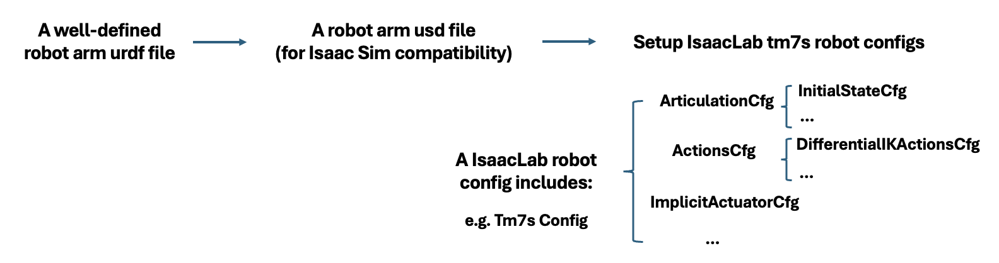
</p>

**Build a complete robot.** The vendor URDF is an arm with a bare flange. A well-known
[Robotiq 2F-85 gripper](https://github.com/KevinGalassi/Robotiq-2f-85) had to be merged into it as one well-defined URDF: the gripper attached to the flange with the right mounting frame, a single kinematic tree, collision geometry that does not self-intersect, and the 2F-85's mimic and closure joints declared properly — that gripper is a linkage, not two independent fingers.

**Convert to USD.** Isaac Sim consumes USD, not URDF. Conversion is where the
mesh naming problem surfaced: names did not survive consistently, so body
lookups by name failed until the export was corrected.

**Write the Isaac Lab robot configuration.** An `ArticulationCfg` holding the
initial joint state, and an `ImplicitActuatorCfg` per joint group with its own
effort, velocity, stiffness and damping — plus a high-PD variant for
differential IK control, the same pattern Isaac Lab uses for the Franka.

**Then the task layer.** Scene configuration, observation groups (proprioception,
RGB camera, subtask terms), action terms for the arm and the gripper separately,
termination conditions, and registration with Gymnasium so the task runs through
Isaac Lab's normal pipeline — teleoperation, recording, Mimic, robomimic
training.

<p align="center">
  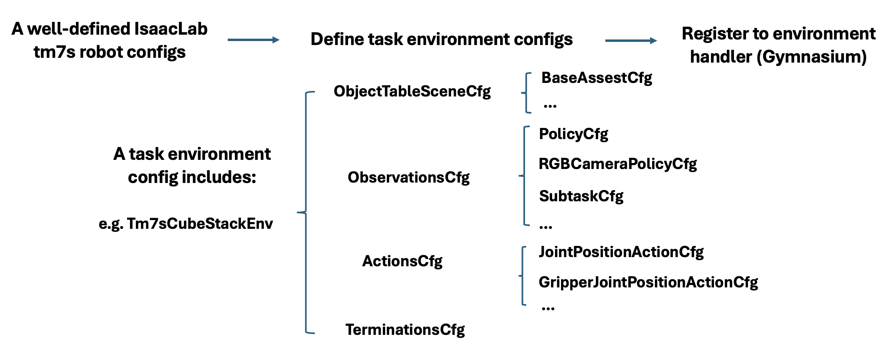
</p>

### The oscillation bug

The arm visibly shook at rest. The cause turned out not to be the arm. The
Robotiq gripper forms a kinematic loop whose mimic and closure joints are
already constrained inside the USD; giving those joints PD gains makes the
actuators fight the constraints, and that energy propagates back up into the
arm.

The fix splits the actuators into four groups and gives the passive joints
**zero** stiffness and damping, letting the USD constraints do the work, with
the arm's shoulder and wrist gains retuned separately on top.

The converted robot ships with the repository as a flattened 30 MB USD, so the
arm loads without chasing down mesh files.

[`docs/tm7s.md`](docs/tm7s.md) ·
[`tm7s.py`](source/isaaclab_assets/isaaclab_assets/robots/tm7s.py) ·
[`the USD`](usd_assets/tm7s_robotiq85_forIsaacLab_flatten.usd) ·
[third-party notices](THIRD_PARTY_NOTICES.md)

---

## Repository layout

```
source/          Isaac Lab overlay: insertion task package, TM7s integration
scripts/         Teleoperation, recording, training, rollout
datasets/        Analysis suite, dataset tooling, rollout results
usd_assets/      Peg and hole-block geometry
images/          Figures
docs/            Benchmark definitions, loss derivation, setup, datasets
```

## Citation

The benchmark and the relative loss are published at IEEE/SICE SII 2027:

```bibtex
@inproceedings{chen2027geometry,
  title     = {Do Robot Policies Adapt to Geometry? Diagnosing and Learning
               Geometry-Conditioned Behavior in Insertion Tasks},
  author    = {Chen, Yen-Chang and Chu, Wei-Ta},
  booktitle = {Proceedings of the IEEE/SICE International Symposium on
               System Integration (SII)},
  address   = {Kobe, Japan},
  year      = {2027},
  note      = {To appear}
}
```

The full study, including the experiments not covered in the paper:

```bibtex
@mastersthesis{chen2026geometry,
  title  = {Do Robot Policies Adapt to Geometry? Diagnosing and Learning
            Geometry-Conditioned Behavior in Insertion Tasks},
  author = {Chen, Yen-Chang},
  school = {National Cheng Kung University},
  year   = {2026}
}
```

## Acknowledgment

This work was carried out at the Multimedia and Computer Vision Laboratory,
National Cheng Kung University, under the supervision of Prof. Wei-Ta Chu.

It was funded in part by the National Science and Technology Council, Taiwan,
under grants 115-2622-8-006-015, 114-2622-E-006-028, 114-2221-E-006-047-MY3,
112-2221-E-006-136-MY3, 115-2425-H-006-005, and 114-2634-F-006-002.

## License

BSD-3-Clause, matching Isaac Lab. See [LICENSE](LICENSE).

The bundled robot USD contains geometry derived from the Techman TM7s and
Robotiq 2F-85 descriptions, both permissively licensed. Their copyright notices
are reproduced in [THIRD_PARTY_NOTICES.md](THIRD_PARTY_NOTICES.md).
