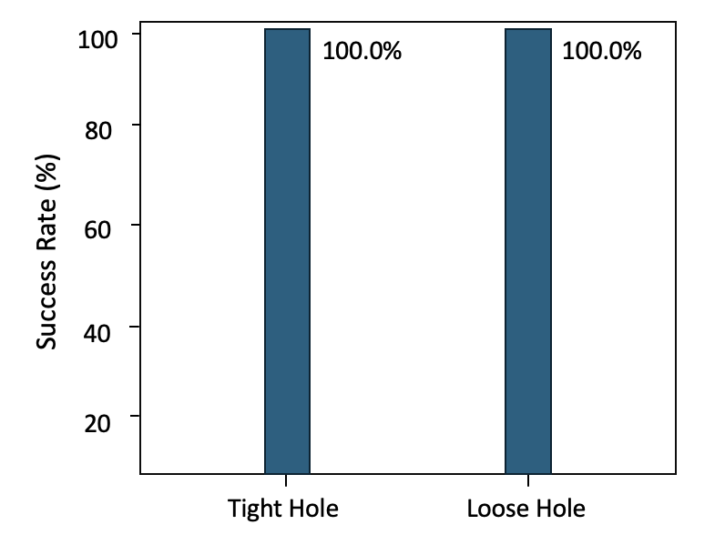
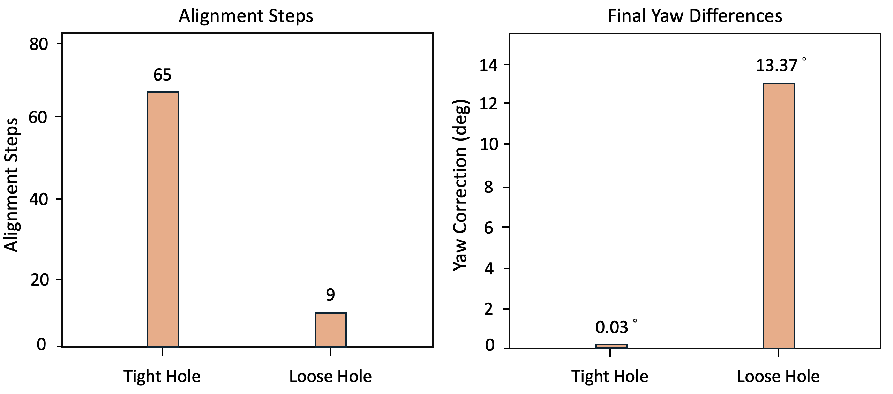
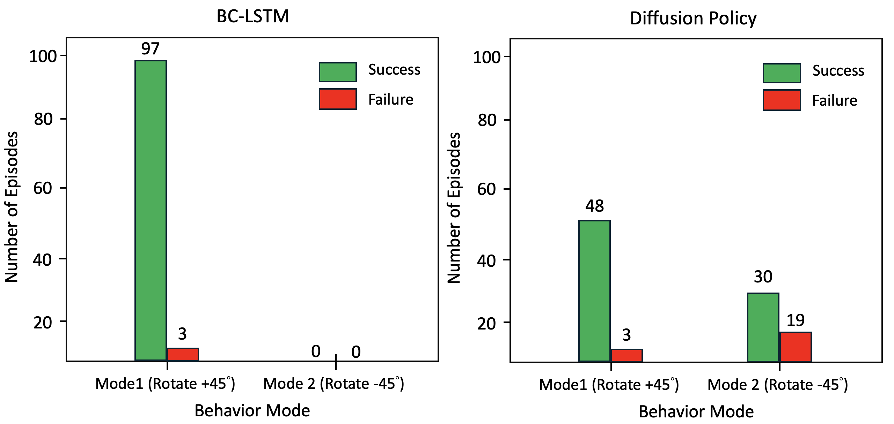
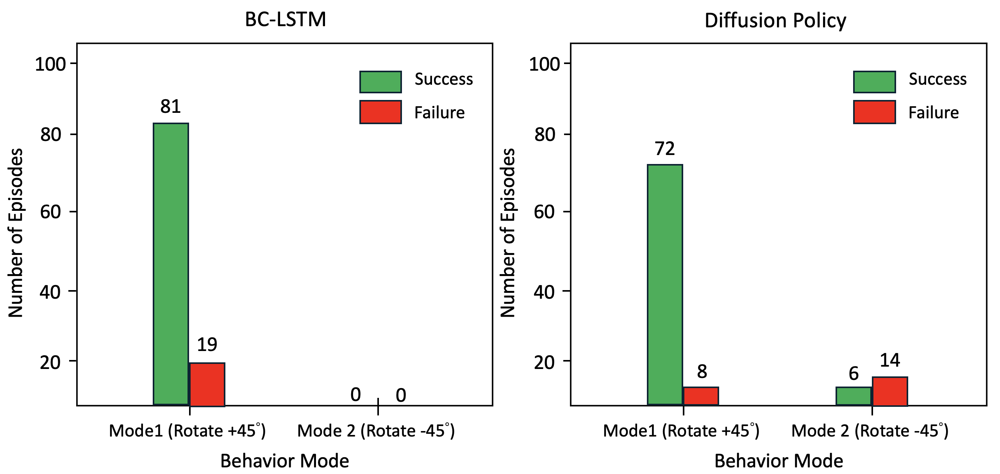
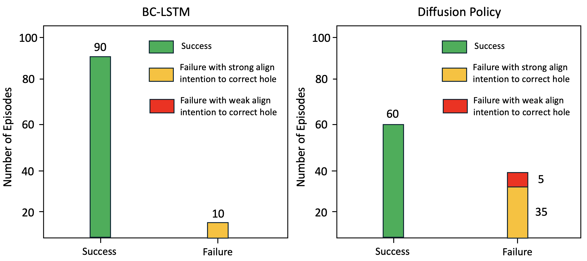
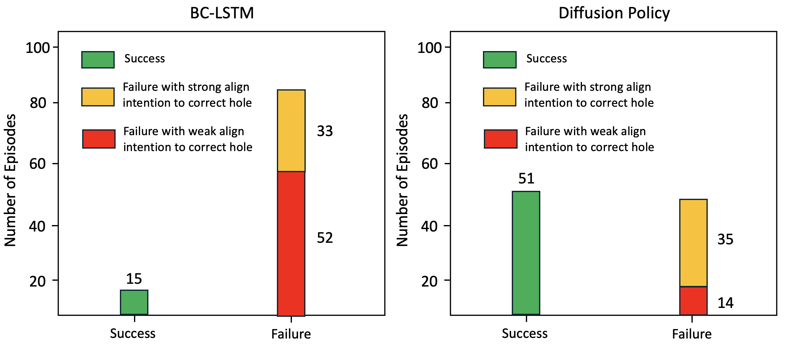
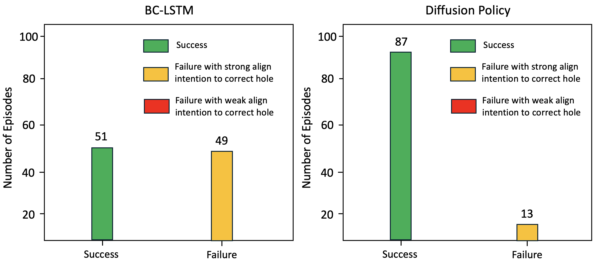
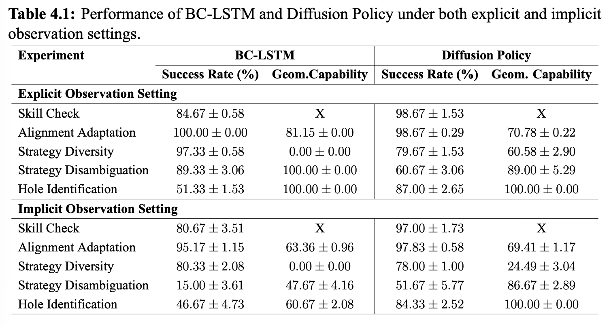
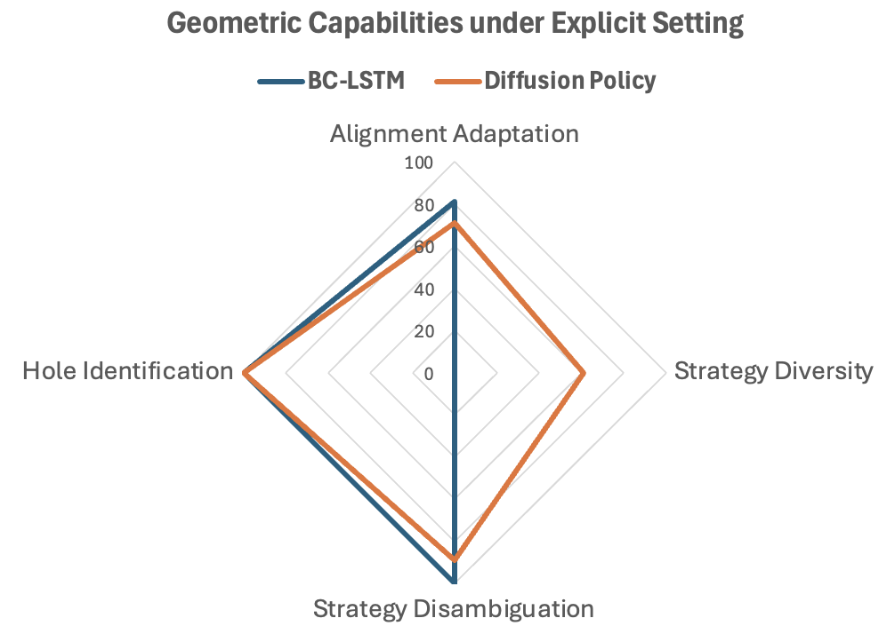
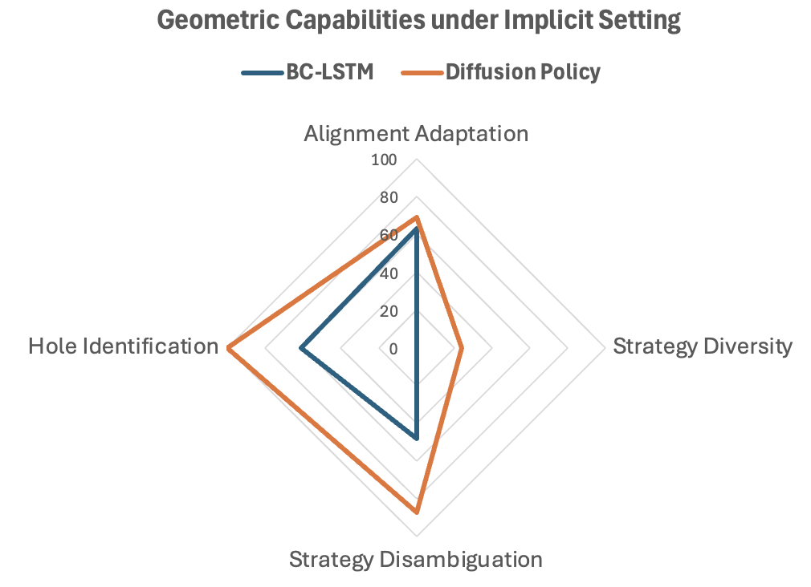

# The geometry-conditioned diagnostic benchmark

Five insertion experiments, each isolating one geometric capability. The
benchmark is **rollout-based** and **model-agnostic**: it consumes rollout
trajectories, so anything that can be rolled out in the environment can be
scored — behavior cloning, diffusion policies, a VLA, a scripted controller.

Two properties shape the design, following the spirit of RoboEval but applied to
geometry rather than trajectory quality and bimanual coordination:

- **Interpretability.** Each metric answers a specific question about *how* the
  task was performed, so a failure points at a cause.
- **Extensibility.** New experiments are added by writing a new environment config in
  the existing insertion task package.

---

## Observation settings

Every experiment runs twice.

**Explicit.** End-effector state plus exact task geometry: peg position and yaw,
hole center position and yaw, hole corner positions, hole size. This isolates
geometric *reasoning* from geometric *perception* — if a policy fails here, it
is not because the encoder could not see the hole.

**Implicit.** A single 200x200 RGB frame from a side-view camera, plus
end-effector position and yaw in the world frame. Nothing else. The policy must
recover geometry from pixels.

Comparing the two separates "cannot see it" from "can see it but does not use
it".

---

## Diagnosis 0 — Skill Check

**Capability:** basic insertion — downward motion control and yaw alignment.

**Setup:** the hole sits directly below the peg with a continuous yaw offset.

**Metric:** success rate only.

A rollout succeeds when the peg bottom reaches the hole bottom while staying
within a bounded region of the hole center in the x-y plane:

```
success = 1[ (z_peg_bottom − z_box_bottom ≤ δz)
             ∧ |x_peg − x_hole| ≤ δx
             ∧ |y_peg − y_hole| ≤ δy ]
```

This experiment is a **prerequisite**. The other four read a policy's behavior
during insertion, which means nothing if the policy cannot insert at all, so
Diagnosis 0 is run first to confirm the basic skill is there. The remaining four
are independent of one another and can be run in any order.

---

## Diagnosis 1 — Alignment Adaptation

**Capability:** geometry-conditioned alignment. Does the policy align *more*
when the hole is tight and *less* when it is loose, or does it apply one
averaged strategy regardless?

**Setup:** the hole is placed at a 15° yaw offset, in two variants that differ
only in hole size. The loose hole admits direct insertion; the tight hole does
not, and requires alignment first.

**Metrics:** two behavioral signals alongside success rate.

- **Alignment steps** `s` — time-steps from the start to the end of alignment
  behavior. Alignment starts when end-effector yaw difference exceeds a
  threshold over a short window, and ends when it falls back below.
- **Final yaw difference** `Δθ` — peg-to-hole yaw at the end of the episode.
  Smaller means more precise alignment.

The capability score averages a tight-hole and a loose-hole term, because the
*correct* behavior differs between them:

```
Score = (Score_tight + Score_loose) / 2
```

For the **loose** hole, a good policy inserts directly: few alignment steps and
a *larger* residual yaw are rewarded.

```
Score_loose = (1/N) Σ 1[ Δθ ≤ ε_loose ∧ s_loose_min ≤ s < s_max ]
              · (Δθ / ε_loose)
              · (1 − (s − s_loose_min) / (s_max − s_loose_min))
```

For the **tight** hole, a good policy aligns precisely and efficiently: fewer
steps and *smaller* residual yaw are rewarded.

```
Score_tight = (1/N) Σ 1[ Δθ ≤ ε_tight ∧ s_tight_min ≤ s < s_max ]
              · (1 − Δθ / ε_tight)
              · (1 − (s − s_tight_min) / (s_max − s_tight_min))
```

Thresholds used: `s_loose_min = 5`, `s_tight_min = 55`, `s_max = 100`,
`ε_loose = 3.2°`, `ε_tight = 15.0°`.

Rewarding opposite behaviors on the two variants is the point. A policy that
always aligns carefully scores well on tight and badly on loose; only a policy
that *switches* scores well on both.

BC-LSTM reaches 100% success on both hole sizes, which on its own says nothing
about whether it switched strategy:

<p align="center">
  
</p>

<!--  -->

The behavioral metrics show that it did. Tight holes trigger longer alignment
and larger yaw corrections, driving the final yaw difference toward zero; loose
holes trigger little or no alignment at all.



---

## Diagnosis 2 — Strategy Diversity

**Capability:** generating multiple valid strategies.

**Setup:** an X-shaped hole that the peg can enter at two orientations — rotate
+45° and insert, or rotate −45° and insert. Both succeed.

**Metric:** the product of the two modes' success rates.

```
Score = SR_mode1 · SR_mode2
```

The product, not the sum. A policy that masters one mode and never attempts the
other scores **zero**, no matter how reliable that one mode is.

| Exact geometry supplied | Camera only |
|:--:|:--:|
|  |  |
| BC 97 / 0 · DP 48 / 30 | BC 81 / 0 · DP 72 / 6 |

This is the experiment where success rate is most misleading, and the only one BC-LSTM
fails under *both* observation settings. Mode 2 is attempted zero times in
either — never attempted, not attempted and failed. Handing the policy the
hole's exact pose and size changes nothing, which rules out perception as the
cause: the architecture cannot represent a second strategy.

Diffusion Policy uses both modes in both settings, though far less often once it
has to work from pixels (20 attempts against 49), which is where its capability
score falls from 60.58 to 24.49. It scores lower on outcome and much higher on
capability in both cases.

---

## Diagnosis 3 — Strategy Disambiguation

**Capability:** selecting the correct strategy from the geometry.

**Setup:** an X-shaped hole with one arm wider than the other. The peg fits
through the big arm and does not fit through the small one, so exactly one of
the two orientations works. The box is placed below the peg at a random yaw
offset drawn from a continuous range, so the correct turn differs every episode
and cannot be memorized — see
[`Diagnosis3_setting_random.mp4`](../images/Diagnosis3_setting_random.mp4).

**Metric:** alignment *intention* toward the correct slot, alongside success
rate.

```
Score = (1/N) Σ 1[ Δθ_to_correct_slot ≤ 10° ]
```

Separating intention from outcome matters here. A rollout can fail because the
policy chose the wrong slot, or because it chose the right slot and aligned
imprecisely. Success rate conflates the two; this metric does not.

| Exact geometry supplied | Camera only |
|:--:|:--:|
|  |  |

Given the hole's exact pose, BC-LSTM identifies the correct slot in 100% of
rollouts and still fails 10 of them — a precision problem, not a recognition
problem. Diffusion Policy recognizes correctly in 95%.

From pixels alone the picture splits. BC-LSTM succeeds 15 times, aims at the
correct slot and misses 33 times, and aims at the wrong slot 52 times: its
failures are now dominated by recognition rather than precision. Diffusion
Policy keeps recognition high — 86 of 100 — and its 49 failures are mostly
(35 of them) still aimed at the right slot.

This is the split the metric exists to expose. Both models "fail" most of the
time under implicit observations, and they fail for different reasons.

---

## Diagnosis 4 — Hole Identification

**Capability:** matching peg shape to hole shape.

**Setup:** three hole shapes in varying arrangements; the peg is drawn at random
from cylindrical, square and rectangular.

**Metric:** whether the peg ends up over the correct hole.

```
Score = (1/N) Σ 1[ ‖p_peg − p_correct_hole‖₂ < r ],   r = 0.2 cm
```

As with Diagnosis 3, this separates recognition from execution.



BC-LSTM under the explicit setting identifies the right hole every time while
succeeding in only 51.3% of rollouts: 49 episodes reach the correct hole and
fail to insert. Diffusion Policy recognizes correctly in 100% of rollouts.

---

## Results

Three runs per experiment, 100 rollouts per run. Capability scores are
multiplied by 100.



### Reading the table

**Explicit setting.** Both policies pass Skill Check. Both adapt alignment to
hole size in Diagnosis 1. Both identify the correct slot and hole in Diagnoses 3
and 4. The single failure is Strategy Diversity, where BC-LSTM scores 0.00 and
Diffusion Policy 60.58 — and where BC-LSTM's success rate is the *higher* of the
two. Judged on outcome alone, BC-LSTM looks like the better policy; judged on
behavior, it is missing a capability entirely.



**Implicit setting.** Diffusion Policy degrades gently, BC-LSTM does not.
Strategy Disambiguation collapses from 89.3% to 15.0% for BC-LSTM while
Diffusion Policy holds 51.7%; Hole Identification recognition falls to 60.67 for
BC-LSTM while Diffusion Policy stays at 100. Diffusion Policy is markedly better
at recovering task-relevant geometry from a single RGB frame.

| Explicit observations | Implicit observations |
|:--:|:--:|
|  |  |

Read together, the two charts separate a reasoning failure from a perception
one. BC-LSTM's Strategy Diversity axis is pinned to zero in *both*, so its
inability to produce a second strategy is not caused by poor perception — it
persists even when the hole's exact pose and size are supplied. Its collapse on
Strategy Disambiguation and Hole Identification, by contrast, appears only under
implicit observations, and is a perception failure.

---

## Scoring a rollout

Roll out a policy with one of the `play_4d_and_save*` scripts, then run the
analysis over the saved per-step log. See [setup.md](setup.md) for the rollout
commands.

```bash
# Level 1 diagnosis: outcome
python datasets/behaviorAnalysis_scripts/Diagnosis_successRate_completionTime.py --input <rollout.hdf5>

# Level 2 diagnosis: behavior
python datasets/behaviorAnalysis_scripts/Diagnosis_alignment.py --input <rollout.hdf5>
python datasets/behaviorAnalysis_scripts/Diagnosis_insertion.py --input <rollout.hdf5>

# Individual behavioral metrics
python datasets/behaviorAnalysis_scripts/BehaviorAnalysis_CalcAlignmentFinishedYawError.py --input <rollout.csv>
python datasets/behaviorAnalysis_scripts/BehaviorAnalysis_CalcAlignmentWiggle.py --input <rollout.csv>
python datasets/behaviorAnalysis_scripts/BehaviorAnalysis_CalcContactPushSpeed.py --input <rollout.csv>
```

The suite also computes metrics not reported in the thesis — contact pause
count, contact wiggle, mean push speed, completion time, a wiggle index — which
are available for extending the benchmark.

`MainExp_alignmentPhaseCheck.py` verifies that the alignment phase was detected
where expected before the alignment metrics are trusted; the
`MainExp_Plot_*` and `DiagnosisExp*_Plot_*` scripts reproduce the per-experiment
figures.
