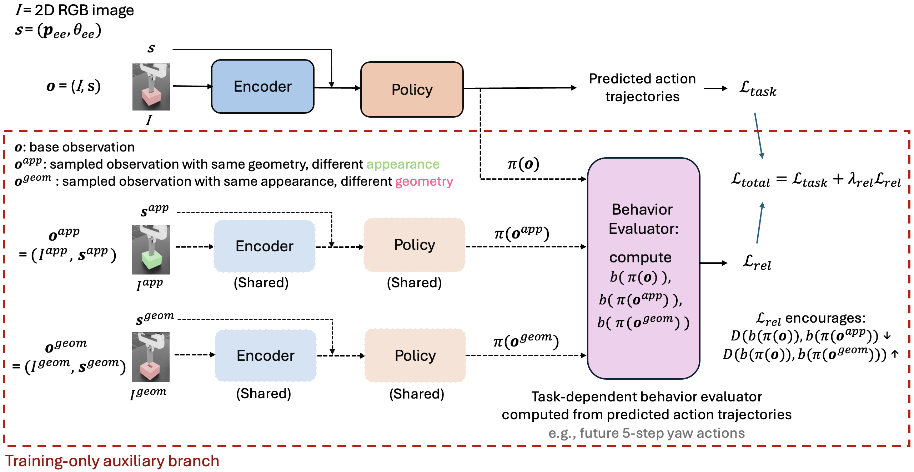
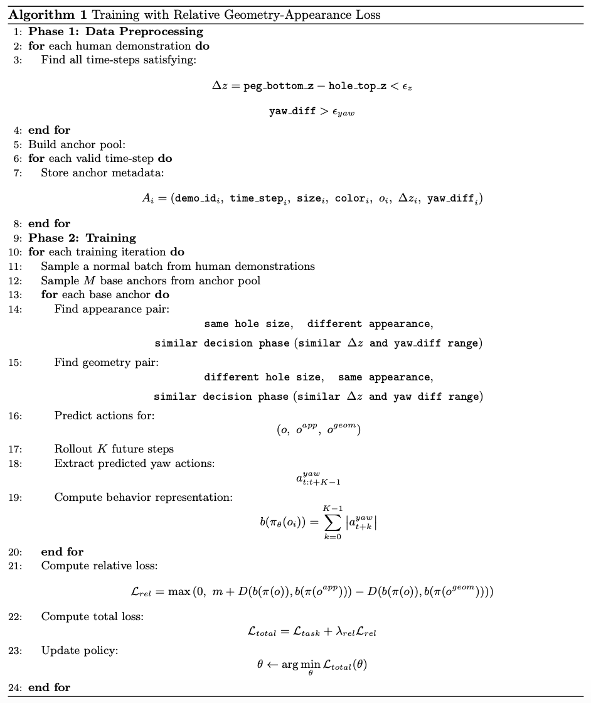
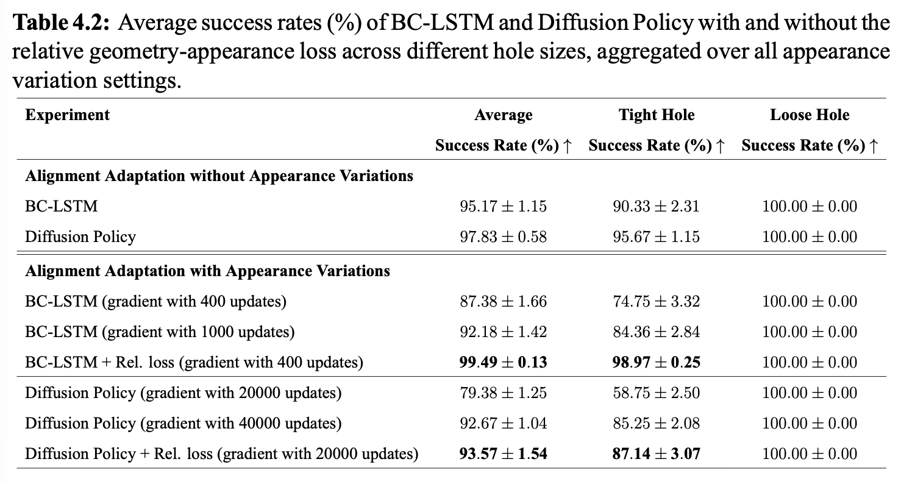
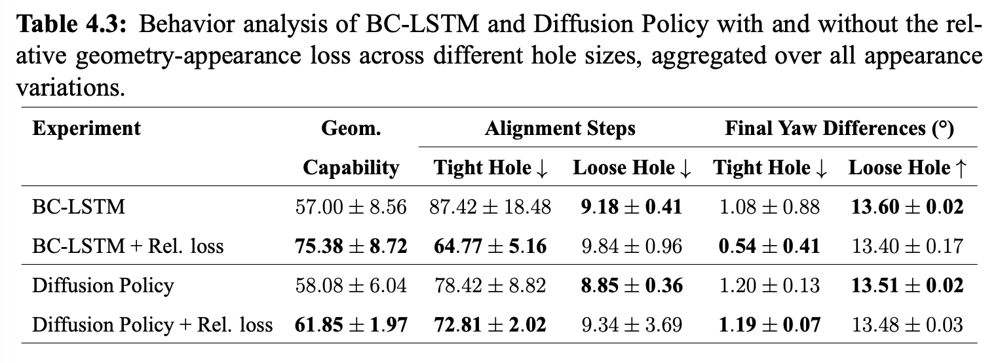
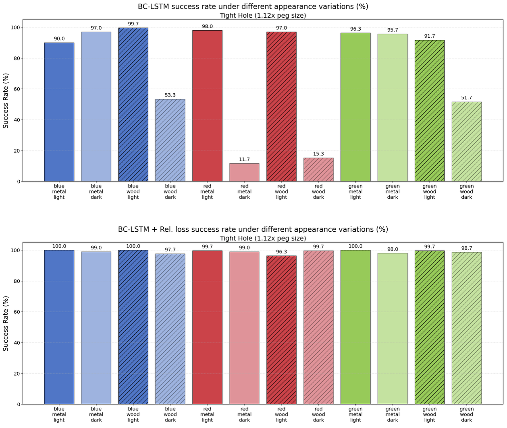

# Relative Geometry-Appearance Loss

A plug-in auxiliary loss for imitation learning. It encourages a policy to be
markedly more sensitive to task-relevant *geometric* variation than to
task-irrelevant *appearance* variation, countering the shortcut learning that
the diagnostic benchmark exposes.

---

## The idea

A human inserting a USB plug adjusts their strategy when the port's geometry
changes, and does not adjust it when the plug is black instead of white. That is
two constraints on behavior:

- appearance changes → behavior should stay **the same**
- geometry changes → behavior should be **different**

Policies trained by plain behavior cloning satisfy neither reliably. They
correlate whatever is visually salient with successful actions, and color is
often more salient than a few millimeters of clearance. Written as a loss, the
two constraints become trainable directly.



---

## Formulation

Let `o` be a base observation — a 200x200 RGB frame `I` plus end-effector state
`s = (p_ee, θ_ee)`. Sample two partners:

- `o_app` — **same** hole geometry, **different** color, peg texture and background
- `o_geom` — **same** appearance, **different** hole size

All three pass through the shared encoder and policy. Their predicted action
trajectories are reduced by a task-dependent **behavior evaluator** `b`, and a
hinge loss separates the two distances:

```
L_rel = max(0,  m + D(b(π(o)), b(π(o_app)))  −  D(b(π(o)), b(π(o_geom))))
```

with `D` the L2 distance and `m` a margin. Minimizing `L_rel` pulls the
appearance pair together and pushes the geometry pair apart. It is added to the
policy's own objective:

```
L_total = L_task + λ_rel · L_rel
```

`L_task` is whatever the base method already uses — the L2 + 0.1·L1 action
reconstruction loss for BC-LSTM, the ε-prediction denoising loss for Diffusion
Policy. The auxiliary branch runs **only during training**; inference is the
unmodified policy, so deployment cost is unchanged.

### Relation to triplet loss

The formulation is FaceNet's triplet loss with the constraint relocated. FaceNet
pulls together and pushes apart *embeddings*, learning a representation in which
identity is preserved. Here the same hinge acts on the **behavior** the policy
produces. Nothing constrains the representation directly; what is constrained is
what the policy *does* with it.

This matters because a policy can encode the hole size perfectly and still
ignore it when choosing actions. A representation-level loss would call that
success. A behavior-level loss will not.

### The behavior evaluator

`b` is the only task-specific component. For Alignment Adaptation the desired
behavior is "insert directly when loose, align carefully when tight", so the
accumulated magnitude of predicted yaw actions over a K-step horizon separates
the two cleanly:

```
b(π(o)) = Σ_{k=0}^{K−1} |a_yaw_{t+k}|
```

A loose hole needs little yaw correction and yields a small value; a tight hole
needs substantial correction and yields a large one.

Other evaluators suit other experiments — one-step yaw actions, short-horizon action
sequences, accumulated contact force magnitude. Choosing `b` is choosing which
axis of behavior the loss constrains.

---

## Implementation



**Phase 1 — build the anchor pool (offline).** Scan every human demonstration
for the time-steps where a geometric decision is actually being made: the peg is
close to the hole surface and still misaligned.

```
Δz = peg_bottom_z − hole_top_z < ε_z
yaw_diff > ε_yaw
```

Each qualifying time-step is stored with its metadata — demo id, time-step, hole
size, color, observation, `Δz`, `yaw_diff`. Anchoring on decision-critical
moments rather than uniformly over the trajectory keeps the loss focused on
steps where geometry should be changing the action.

On the 120 MainExp demonstrations these thresholds select **2,578 anchors**
out of 11,321 recorded time-steps — 22.8%, about 21 per episode. Tight
enough to exclude the long approach and the final descent, loose enough that
every demonstration contributes.

```bash
python datasets/behaviorAnalysis_scripts/MainExp_createAnchorPool.py \
    --input datasets/MainExp_dataset_forTraining.hdf5 \
    --yaw-error-threshold 3.5 --z-diff-max 0.0125
```

This writes an HDF5 anchor pool (the file training consumes) and a CSV of the
same metadata for inspection.

**Phase 2 — train.** Each iteration draws a normal batch plus `M` anchors. For
every anchor, an appearance pair and a geometry pair are found at a *similar
decision phase* — comparable `Δz` and `yaw_diff` ranges — so the comparison is
not confounded by the peg being at a different stage of the insertion.

```bash
# BC-LSTM
python scripts/imitation_learning/robomimic/train_bc_with_geoRelLoss_mainExp.py \
    --dataset datasets/MainExp_dataset_forTraining.hdf5 \
    --anchor_pool datasets/MainExp_dataset_anchorPool_forTraining.hdf5 \
    --lambda_rel 0.1 --geo_rel_M 16 --geo_rel_margin 0.3

# Diffusion Policy
python scripts/imitation_learning/robomimic/train_dp_with_geoRelLoss_mainExp.py \
    --dataset datasets/MainExp_dataset_forTraining.hdf5 \
    --anchor_pool datasets/MainExp_dataset_anchorPool_forTraining.hdf5 \
    --lambda_rel 0.1
```

| Flag | Meaning | Used |
|---|---|---|
| `--lambda_rel` | weight of the auxiliary term | 0.1 |
| `--geo_rel_M` | anchor triplets per gradient step | 16 |
| `--geo_rel_margin` | hinge margin `m` | 0.3 |
| `--anchor_pool` | path to the Phase 1 HDF5 | — |

---

## Results

Evaluated on **Alignment Adaptation with Appearance Variations** — Diagnosis 1
extended with color, peg texture and background changes — under the implicit
observation setting only.

### Success rate

| | Gradient updates | Average | Tight hole | Loose hole |
|---|---|---|---|---|
| *Without appearance variation* | | | | |
| BC-LSTM | — | 95.17 ± 1.15 | 90.33 ± 2.31 | 100.00 |
| Diffusion Policy | — | 97.83 ± 0.58 | 95.67 ± 1.15 | 100.00 |
| *With appearance variation* | | | | |
| BC-LSTM | 400 | 87.38 ± 1.66 | 74.75 ± 3.32 | 100.00 |
| BC-LSTM | 1,000 | 92.18 ± 1.42 | 84.36 ± 2.84 | 100.00 |
| **BC-LSTM + Rel. loss** | **400** | **99.49 ± 0.13** | **98.97 ± 0.25** | 100.00 |
| Diffusion Policy | 20,000 | 79.38 ± 1.25 | 58.75 ± 2.50 | 100.00 |
| Diffusion Policy | 40,000 | 92.67 ± 1.04 | 85.25 ± 2.08 | 100.00 |
| **Diffusion Policy + Rel. loss** | **20,000** | **93.57 ± 1.54** | **87.14 ± 3.07** | 100.00 |

Both methods, at a fraction of the gradient steps, beat baselines trained for
2.5x (BC) and 2x (DP) longer. The loose hole is saturated throughout and carries
no signal; the tight hole is where the difficulty lives.

<details><summary>Source table</summary>



</details>

### Behavior

| | Geom. capability | Alignment steps (tight) | Final yaw diff (tight) |
|---|---|---|---|
| BC-LSTM | 57.00 ± 8.56 | 87.42 ± 18.48 | 1.08° ± 0.88 |
| **BC-LSTM + Rel. loss** | **75.38 ± 8.72** | **64.77 ± 5.16** | **0.54° ± 0.41** |
| Diffusion Policy | 58.08 ± 6.04 | 78.42 ± 8.82 | 1.20° ± 0.13 |
| **Diffusion Policy + Rel. loss** | **61.85 ± 1.97** | **72.81 ± 2.02** | **1.19° ± 0.07** |

<details><summary>Source table</summary>



</details>

Success rate rises *and* alignment becomes shorter and more precise, which rules
out the obvious alternative explanation — that the policy simply learned to
align more aggressively everywhere. It aligns **less** and lands **closer**. The
variance on alignment steps also drops sharply (±18.5 → ±5.2), consistent with a
policy that has stopped hesitating over whether more rotation is needed.

### Per-appearance breakdown



The aggregate numbers understate the effect. The baseline's tight-hole success
ranges from **11.7% to 99.7%** across the twelve appearance conditions, with the
dark backgrounds collapsing hardest. With the loss the range is **96.3% to
100%**.

Alignment steps and final yaw difference show the same flattening:
[`alignmentSteps`](../images/RelLoss_BCvsBCRel_alignmentSteps_byAppearance.png) ·
[`finalYawDiff`](../images/RelLoss_BCvsBCRel_finalYawDiff_byAppearance.png)

---

## Scope and limitations

**Validated on one experiment.** Diagnosis 1 with appearance variations, implicit
observations. Diagnoses 0, 2, 3 and 4 are diagnosed by the benchmark but not
treated by the loss. The results above do not claim improvement there.

**The behavior evaluator is hand-designed.** The yaw-magnitude form suits
alignment. Extending to Strategy Diversity needs an evaluator over the
*distribution* of predicted modes rather than a scalar magnitude, since the
failure there is collapse onto one mode rather than an incorrect amount of
rotation. Strategy Diversity is also where the headroom is largest — BC-LSTM scores a
flat 0.00 — so it is the natural next experiment.

**Appearance pairs come from the dataset.** The loss needs demonstrations that
already span appearance and geometry, so an anchor's partners can be found. It
does not synthesise variations, and cannot be applied to a dataset recorded
under a single appearance.

**Single task, single embodiment.** Peg-in-hole insertion with a Franka Panda in
simulation. No claim is made about transfer to other tasks or to hardware.
