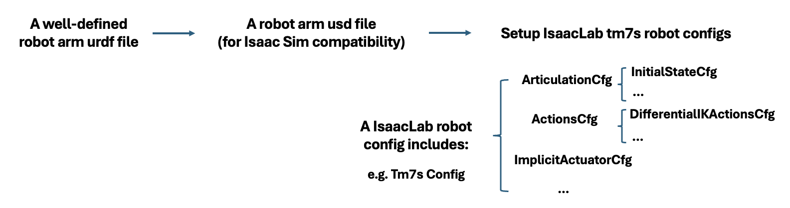
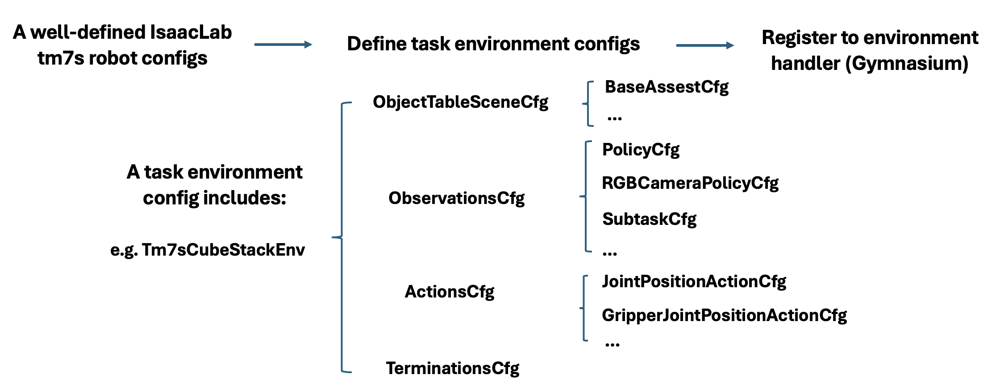

# Techman TM7s in Isaac Lab

A side contribution, independent of the thesis. The insertion benchmark uses a
Franka Panda throughout; nothing here feeds into it.

The Techman TM7s collaborative arm with a Robotiq 2F-85 gripper was brought into
Isaac Lab in collaboration with a Taiwanese robotics manufacturer, and kept in
the open as a contribution to the local robotics community — Techman publishes
its own Isaac Sim assets, but they do not come up cleanly in Isaac Lab.

## Starting point

Techman publishes a URDF for the TM7s arm. That is all — no gripper, no Isaac
Sim asset, no Isaac Lab configuration. Every layer between that file and a task
you can teleoperate and train on had to be built.



### 1. A complete robot in one URDF

The vendor file describes a 6-DoF arm ending in a bare flange. A Robotiq 2F-85
gripper was merged into it to produce a single well-defined URDF:

- the gripper mounted on the flange with the correct frame and offset, so the
  end-effector pose means what the controller thinks it means
- one kinematic tree, no orphaned links
- collision geometry that does not self-intersect at the wrist
- the 2F-85's **mimic and closure joints declared properly** — the gripper is a
  four-bar linkage driven by one joint, not two independent fingers, and getting
  this wrong is what later caused the oscillation described below

### 2. URDF to USD

Isaac Sim consumes USD. The conversion is where the **mesh naming** problem
surfaced: names did not survive consistently, so body lookups by name failed
until the export was corrected. The resulting USD is referenced through
`TM7S_USD_PATH`.

### 3. The Isaac Lab robot configuration

[`robots/tm7s.py`](../source/isaaclab_assets/isaaclab_assets/robots/tm7s.py)
defines an `ArticulationCfg` carrying:

- `InitialStateCfg` — the home joint configuration for arm and gripper
- rigid-body and articulation solver properties
- an `ImplicitActuatorCfg` per joint group, each with its own effort limit,
  velocity limit, stiffness and damping

`TM7S_ROBOTIQ85_HIGH_PD_CFG` is the stiffened variant used for differential IK
control, following the pattern Isaac Lab uses for the Franka.

### 4. The task layer



With a working robot config, the cube-stacking task is assembled the way Isaac
Lab expects — scene, observations, actions, terminations — and registered with
Gymnasium so it runs through the standard pipeline:

| Layer | Contents |
|---|---|
| Scene | table, cubes, camera and robot placement |
| Observations | proprioception, RGB camera group, subtask terms |
| Actions | arm joint-position or differential-IK terms, plus a separate gripper action term |
| Terminations | success and failure conditions per subtask |

Registered as `Isaac-Stack-Cube-Tm7s-IK-Rel-Mimic-v0`, which makes the arm
usable with Isaac Lab's teleoperation, demonstration recording, Mimic data
generation and robomimic training without further changes.

## What is here

| File | Contents |
|---|---|
| [`robots/tm7s.py`](../source/isaaclab_assets/isaaclab_assets/robots/tm7s.py) | `ArticulationCfg` for TM7s + Robotiq 2F-85, plus the high-PD variant for IK control |
| [`tm7s_stack_ik_rel_mimic_env.py`](../source/isaaclab_mimic/isaaclab_mimic/envs/tm7s_stack_ik_rel_mimic_env.py) | Isaac Lab Mimic environment and its registration |
| [`tm7s_stack_env_cfg.py`](../source/isaaclab_tasks/isaaclab_tasks/manager_based/manipulation/stack/tm7s_stack_env_cfg.py) | Cube-stacking task configuration |
| [`tm7s_mdp/`](../source/isaaclab_tasks/isaaclab_tasks/manager_based/manipulation/stack/tm7s_mdp) | Observation, termination and event terms for the 6-DoF arm |
| [`config/tm7s/`](../source/isaaclab_tasks/isaaclab_tasks/manager_based/manipulation/stack/config/tm7s) | Joint-position and IK-relative variants with robomimic agent configs |

About 2,180 lines.

The converted robot ships with this repository as
[`usd_assets/tm7s_robotiq85_forIsaacLab_flatten.usd`](../usd_assets/tm7s_robotiq85_forIsaacLab_flatten.usd)
— a flattened export, 30 MB, with the meshes baked in so it loads on its own:

```bash
export TM7S_USD_PATH=usd_assets/tm7s_robotiq85_forIsaacLab_flatten.usd
```

The unflattened version and its separate mesh files are not included; they are
only useful for re-editing the asset.

## The oscillation bug

The arm visibly oscillated at rest. The cause is the Robotiq 2F-85's kinematic
loop: the gripper's mimic and closure joints are constrained inside the USD, and
giving them PD gains makes the actuators fight those constraints, injecting
energy that propagates back into the arm.

The fix splits the actuators into four groups and gives the passive joints no
gains at all:

```python
"gripper_drive": ImplicitActuatorCfg(          # the one commanded joint
    joint_names_expr=["robotiq_85_left_knuckle_joint"],
    stiffness=50.0, damping=1.0,
),
"gripper_finger": ImplicitActuatorCfg(         # inner knuckles, barely driven
    joint_names_expr=[
        "robotiq_85_left_inner_knuckle_joint",
        "robotiq_85_right_inner_knuckle_joint",
    ],
    stiffness=0.2, damping=0.001,
),
"gripper_passive": ImplicitActuatorCfg(        # mimic / closure joints
    joint_names_expr=[
        "robotiq_85_right_knuckle_joint",
        "robotiq_85_left_finger_tip_joint",
        "robotiq_85_right_finger_tip_joint",
    ],
    stiffness=0.0, damping=0.0,                # let the constraints do the work
),
```

The arm is split into shoulder (`joint_1-3`) and wrist (`joint_4-6`) groups so
the heavier proximal joints can be tuned separately:

| Group | Effort limit | Velocity limit | Stiffness | Damping |
|---|---|---|---|---|
| shoulder | 170.0 | 3.665 | 120.0 | 6.0 |
| wrist | 45.0 | 7.854 | 80.0 | 4.0 |

`TM7S_ROBOTIQ85_HIGH_PD_CFG` raises these to 400/80 and 300/60 for
differential-IK control, following the same pattern Isaac Lab uses for the
Franka.

## Known limitations

- Validated on cube stacking only; not used for insertion.
- The gripper is modeled with a single drive joint plus passive followers. It
  holds objects reliably enough for pick-and-place, but is not calibrated for
  contact-rich force control.
